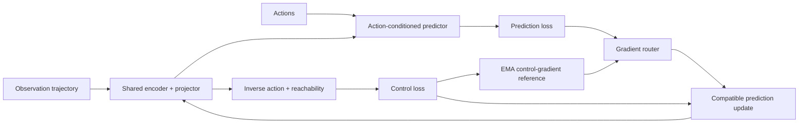

# Control-Supported Representation Learning for Visual World Models

### Redirecting an obsessed encoder with action-derived control evidence

> **Predict what is predictable. Preserve what matters for control.**

> **Status:** research preview. The implementation and registered diagnostics
> are available; the reported control results currently use one training seed.

Joint-embedding predictive world models can learn accurate latent predictions
while organizing their representation around a persistent but
decision-irrelevant visual feature. This repository studies that failure in
end-to-end visual world models and introduces a control-protected optimization
interface for the shared encoder.

Our central example is **Tagged PushT**: a `5 x 5` RGB square is added to the
upper-left corner of every observation. Its color is fixed within each episode,
so it is exceptionally easy to predict, but it changes neither the physical
dynamics nor the expert action. Prediction-only JEPA assigns this tag far more
latent distance than matched physical motion and consequently makes planning
sensitive to tag identity.

We use action-derived control evidence to constrain how prediction may update
the shared representation. The predictor still receives its full learning
signal; only the prediction gradient entering the encoder is routed.

## Method at a glance



Let `L_control` combine inverse-action and reachability supervision, and let
`L_pred` be the action-conditioned latent prediction loss. For the shared
encoder parameters, we maintain an exponential moving average of the control
gradient:

```text
g_c       = grad_theta L_control
m_t       = beta * m_(t-1) + (1 - beta) * g_c
g_pred^⊥  = g_pred - <g_pred, m_t> / (||m_t||² + eps) * m_t

g_shared  = g_c + lambda_pred * g_pred^⊥ + g_reg
```

The control gradient is never projected. Prediction retains the complementary
high-dimensional parameter subspace, and predictor-private parameters receive
the original, unmodified prediction gradient.

This is a **local optimization safeguard**, not a claim that one control
gradient identifies every task-relevant semantic direction. The construction
reduces direct first-order interference with the EMA control reference while
leaving higher-order, stochastic, and long-horizon effects possible.

Key implementation:

- [`bloop_gradient_routing.py`](leworldmodel/additional_files/bloop_gradient_routing.py) — parameter-space EMA memory and gradient projection.
- [`train.py`](leworldmodel/train.py) — integration at the shared encoder/projector boundary.
- [`interface_cycle_campaign.py`](leworldmodel/additional_files/interface_cycle_campaign.py) — matched training and evaluation campaign.
- [`paper/`](paper/) — working manuscript under active revision.

## Evidence chain

We deliberately separate four questions that a single downstream score cannot
answer:

1. **Information presence:** what remains linearly decodable from a frozen representation?
2. **Geometric allocation:** how much latent distance is assigned to tag-only versus physical change?
3. **Planner use:** does changing only the tag alter candidate costs, rankings, or the selected action sequence?
4. **Closed-loop control:** does the learned representation support online CEM planning?

### Tagged PushT representation probes

Frozen ridge probes use the same 1,024 clips for every model. Higher `R²` is
better; a negative value is worse than predicting the test-set mean.

| Method | Pusher `R²` | Block xy `R²` | Block angle `R²` | Tag RGB `R²` |
|---|---:|---:|---:|---:|
| JEPA | 0.234 | 0.377 | -0.168 | **0.946** |
| Ours | **0.996** | **0.953** | **0.689** | 0.919 |

The tag remains decodable. The method therefore performs **feature
reallocation**, not nuisance erasure: physical state becomes substantially
more accessible while the tag loses geometric and decision-making dominance.

### Matched latent allocation

For each of 128 matched trajectories, we compare the latent path length caused
by a tag-only RGB sweep with the path length caused by physical motion:

```text
allocation ratio = tag-only latent path length / physical latent path length
```

One denotes equal allocation; lower is preferable.

| Method | Geometric mean | 95% bootstrap CI | Median |
|---|---:|---:|---:|
| JEPA | 20.87 | [18.85, 23.11] | 20.89 |
| Ours | **1.42** | **[1.34, 1.51]** | **1.38** |

### Fixed-candidate counterfactual planning

We freeze the physical context, physical goal, and the same bank of 32
candidate action sequences, then change only the `5 x 5` RGB tag. Lower is
better for all three metrics.

| Method | Pair-order reversal | Selected candidate changed | Normalized cost distortion |
|---|---:|---:|---:|
| JEPA | 9.84% | 69.53% | 58.36% |
| Ours | **2.27%** | **7.03%** | **10.78%** |

- **Pair-order reversal** measures how often a pair of candidate trajectories
  swaps relative rank after the tag change.
- **Selected candidate changed** tests whether the minimum-cost action sequence
  changes.
- **Normalized cost distortion** is the tag-induced cost RMSE divided by the
  standard deviation of the reference candidate costs.

These interventions show that the tag is not merely decodable under JEPA: it
causally changes the cost landscape used by the planner.

### Online CEM planning

Each result below uses 50 evaluation episodes, training seed 0, and evaluation
seed 42.

| Task | Condition | Ours |
|---|---|---:|
| PushT | clean | 92% |
| PushT | tagged | 88% |
| Reacher | clean | 88% |
| TwoRoom | clean | **96%** |
| Cube | clean | 80% |

These are single-training-seed pilot results, not multi-seed estimates or a
state-of-the-art leaderboard. The campaign and diagnostic scripts linked below
record the exact frozen-checkpoint protocols.

## Repository layout

| Path | Contents |
|---|---|
| [`leworldmodel/`](leworldmodel/) | Latent world-model training, planning, Tagged PushT, our routing method, and diagnostics |
| [`paper/`](paper/) | Working manuscript; the public-facing draft is still being synchronized with the final experiments |
| [`article/`](article/) | Technical notes, claim ledger, and experiment plans |
| [`lejepa/`](lejepa/) | LeJEPA predictable-feature reproduction |
| [`dinov3/`](dinov3/) | DINOv3 predictable-feature reproduction |
| [`common/`](common/) | Shared rendering and experiment utilities |
| [`VERIFYING.md`](VERIFYING.md) | Audit trail for modifications to vendored upstream code |

## Installation

The environment is pinned for Python 3.12 and CUDA-enabled PyTorch. We use
[`uv`](https://docs.astral.sh/uv/) for reproducible dependency management.

```bash
git clone --branch experiment/randgoal-decision-aligned \
  https://github.com/Enigma-Incorporated/The-Obsessed-Encoder.git
cd The-Obsessed-Encoder
uv sync --frozen
```

For offline experiment logging:

```bash
export WANDB_MODE=offline
```

The campaign launchers accept environment overrides for all machine-specific
storage. Set these before running outside the authors' cluster:

```bash
export STABLEWM_HOME=/path/to/stablewm-data-and-checkpoints
export LOCAL_DATASET_DIR="$STABLEWM_HOME"
export SPT_CACHE_DIR=/path/to/cache/stable-pretraining
export XDG_CACHE_HOME=/path/to/cache/xdg
export TMPDIR=/path/to/scratch
```

Run the CPU test suite:

```bash
uv run pytest -m "not gpu"
```

Run the focused gradient-routing tests:

```bash
uv run pytest -q \
  leworldmodel/additional_files/tests/test_bloop_gradient_routing.py \
  leworldmodel/additional_files/tests/test_interface_cycle_campaign.py
```

## Reproducing the control-protected experiments

The full campaign launcher targets a Slurm cluster. It performs a preflight
test, trains matched task configurations, and schedules the corresponding
50-episode evaluations:

```bash
uv run python leworldmodel/additional_files/interface_cycle_campaign.py \
  --routing bloop \
  --benchmarks tagged_pusht,clean_pusht,clean_reacher,clean_tworoom,clean_cube \
  --submit
```

Without `--submit`, the launcher prints the experiment plan without creating
Slurm jobs. Cluster-specific partitions and node constraints can be supplied
through its command-line options.

The main tagged-PushT diagnostic entry points are:

- [`bloop_tagged_diagnostics_campaign.py`](leworldmodel/additional_files/bloop_tagged_diagnostics_campaign.py) — frozen probes and matched diagnostics.
- [`bloop_feature_allocation_campaign.py`](leworldmodel/additional_files/bloop_feature_allocation_campaign.py) — tag/physical latent-path allocation.
- [`bloop_counterfactual_visual_campaign.py`](leworldmodel/additional_files/bloop_counterfactual_visual_campaign.py) — fixed-candidate tag interventions.
- [`bloop_paper_visuals_campaign.py`](leworldmodel/additional_files/bloop_paper_visuals_campaign.py) — paper-facing figures from archived results.

Datasets and generated results are intentionally not committed. Runners use
`DATA_DIR`, `RESULTS_DIR`, and `STABLEWM_HOME` to keep large artifacts outside
the source tree.

## Repository lineage

This repository began as the companion code for Enigma's
[**The Obsessed Encoder**](https://www.enigma.inc/posts/obsessed-encoder), which
demonstrated that a faint, predictable visual feature can dominate
self-supervised representations across LeJEPA, DINOv3, and LeWorldModel. The
current work builds on that diagnosis and asks how to repair the optimization
interface of an end-to-end latent world model.

Vendored upstream implementations are modified only inside explicitly marked,
default-inert blocks:

```python
# >>> obsessed-encoder: <what and why>
...
# <<< obsessed-encoder
```

See [`VERIFYING.md`](VERIFYING.md) and the `additional_files/README.md` inside
each reproduction for the complete change inventory and upstream commit pins.

## Current scope and limitations

- Reported planning results currently use one training seed and one evaluation
  seed; multi-seed validation remains necessary.
- The protected EMA direction is a local, noisy proxy for current control
  demand, not a complete semantic oracle.
- Orthogonalizing a prediction update provides a local first-order statement;
  it does not guarantee invariance over finite Adam updates or long training.
- Tagged PushT uses a deliberately controlled, episode-constant nuisance.
  Richer and naturally occurring distractors remain future work.

## Acknowledgements

This codebase builds on
[LeJEPA](https://arxiv.org/abs/2511.08544),
[LeWorldModel](https://arxiv.org/abs/2603.19312),
[DINOv3](https://arxiv.org/abs/2508.10104), and
[Bloop](https://arxiv.org/abs/2402.02998). Refer to the vendored projects and
their respective licenses before redistributing derived code.
